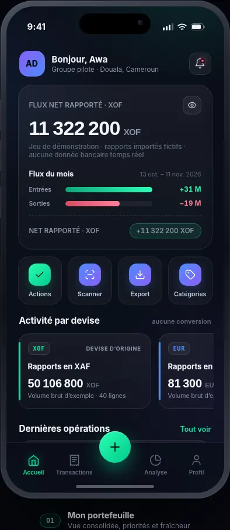
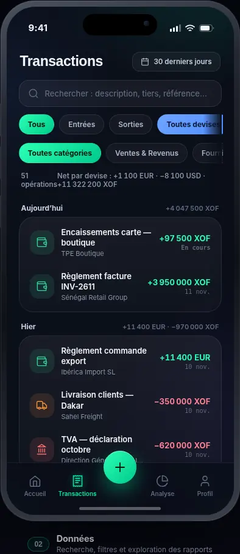
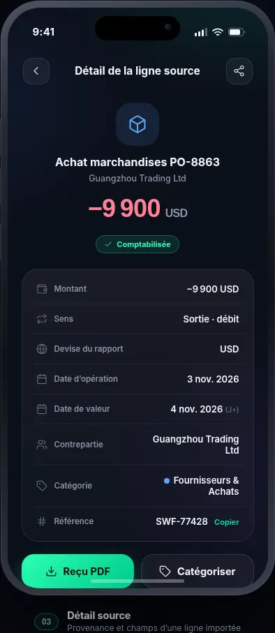
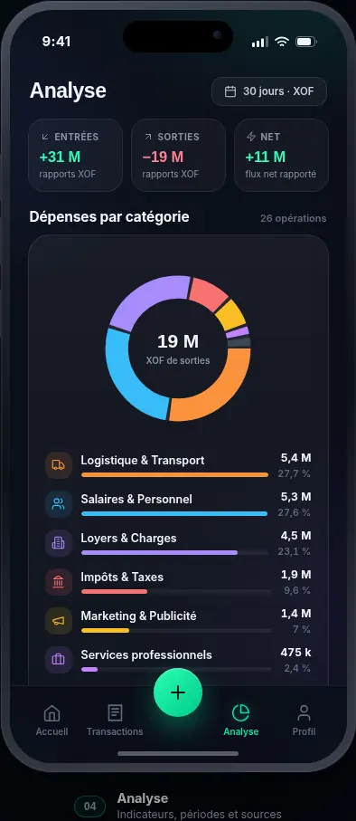
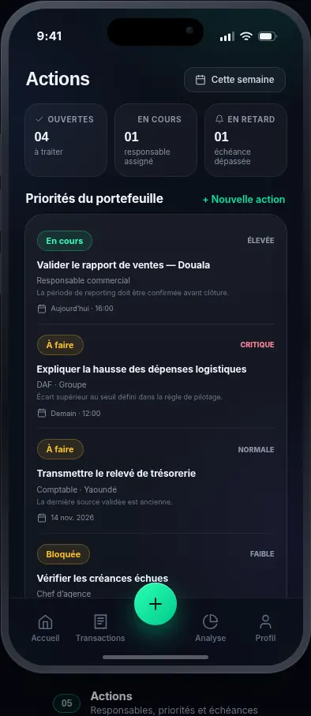
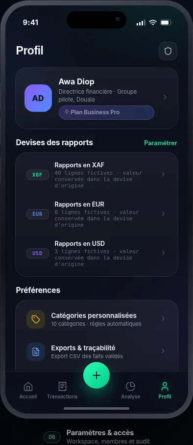

# YFEN — AI Business Control Tower

**Le cockpit de pilotage multi-activités des dirigeants de PME et groupes en Afrique francophone.**

YFEN réunit des rapports de gestion déjà produits (Excel, CSV et certains PDF textuels), rend la provenance des chiffres visible, met en évidence des exceptions et structure les actions du dirigeant. Il ne remplace pas les ERP, logiciels comptables, caisses ou outils métiers existants.

> **État : socle full-stack de MVP en développement.** Les parcours principaux sont codés, mais les migrations initiales, l’exécution réelle de la CI, la recette navigateur et une revue indépendante de sécurité restent des gates avant pilote client. Ne pas y charger de données financières client en l’état.

## Décisions produit non négociables

- P0 : workspace & portefeuille, entités, imports et qualité, cockpit traçable, alertes explicables, centre d’actions, administration et audit.
- P1 : AI Executive Brief et Q&A limité, uniquement après validation des imports et KPI.
- Hors MVP : ERP, comptabilité réglementaire, paie, POS, virements/paiements, banque ou Mobile Money en temps réel, agent IA autonome, OCR de masse.
- Aucune somme multi-devises sans méthode de conversion documentée. Les valeurs sont séparées par entité, période et devise.
- Les faits sont d’abord préparés en `REVIEW` ; seuls les faits confirmés par un utilisateur autorisé alimentent le cockpit.

## Stack

| Couche | Technologie |
| --- | --- |
| Frontend | React 19.3.0, TypeScript 5.9, Vite 8.3, PWA responsive |
| Backend | Python 3.12+, Django 6.1.3, Django REST Framework 3.18.3 |
| Base | PostgreSQL 17 (Docker), SQLite en développement local |
| Fichiers | Stockage privé Django ; pipeline objet S3 à configurer pour le staging/prod |
| Parsing | `openpyxl`, CSV standard, `pdfplumber` pour extraction de texte assistée |
| Jobs | Celery + Redis configurés pour évolution ; parsing actuel synchrone et borné |
| Déploiement dev | Docker Compose |

## Fonctionnalités codées

- Inscription, connexion, déconnexion et token API.
- Création du workspace avec attribution automatique du rôle OWNER.
- Création et liste d’entités et unités opérationnelles.
- Ajout d’un compte YFEN existant comme membre du workspace avec rôle.
- Upload CSV/XLSX/PDF en quarantaine, SHA-256 et rejet des doublons dans le workspace.
- Prévisualisation de colonnes/lignes, mapping de montant/date, contrôle de lignes et file de revue.
- Relevés bancaires : la colonne doit explicitement être un solde et le cockpit conserve le dernier solde daté, jamais la somme des mouvements.
- Confirmation humaine et publication de faits validés uniquement.
- Cockpit avec agrégations Decimal déterministes et provenance par lot source.
- Alertes sur actions en retard, absence de premier rapport validé et ancienneté > 30 jours.
- Centre d’actions : création, responsable, priorité, échéance, statut et commentaires API.
- Audit des mutations principales, export CSV des faits validés.
- Frontend responsive : portefeuille, entreprises, imports, actions, analyse et paramètres.
- Service worker limité au shell statique ; aucune donnée API n’est mise en cache.

Consulte [l’état d’implémentation](docs/implementation-status.md) pour les limites précises.

## Aperçu de l’interface (mockup)

Ces captures proviennent du **mockup HTML interactif** fourni et adapté au périmètre YFEN. Elles illustrent la direction visuelle et les parcours cibles ; elles ne sont pas des captures de l’application React connectée à une API réelle.

| Écran | Aperçu |
| --- | --- |
| Mon portefeuille |  |
| Entreprises |  |
| Imports |  |
| Centre d’actions |  |
| Analyse |  |
| Paramètres & accès |  |

La maquette conserve le thème dark fintech, mais remplace le parcours de virement par le centre d’actions prévu au PRD. Les montants et activités visibles sont fictifs.

## Arborescence

```text
YFEN/
├── backend/
│   ├── apps/{identity,tenancy,sources,actions,alerts,audit,api}/
│   └── config/
├── frontend/
│   ├── public/                 # Manifest et service worker PWA
│   └── src/                    # React + client API + design system
├── docs/
│   ├── PRD.md
│   ├── architecture.md
│   ├── security-and-data-governance.md
│   ├── roadmap.md
│   ├── implementation-status.md
│   └── design/yfen-mockup.html
├── sample-data/
├── docker-compose.yml
├── .env.example
└── .github/workflows/ci.yml
```

## Prérequis

- Docker Desktop avec moteur Linux/WSL2 activé (Windows) ; ou
- Python 3.12+, Node.js 22.12+ et PostgreSQL 17 (Redis optionnel en local) ;
- Git.

## Démarrage Windows / WSL2 avec Docker

1. Clone le dépôt et entre dans le dossier :

   ```bash
   git clone https://github.com/Fred4real3times/YFEN.git
   cd YFEN
   ```

2. Crée le fichier de configuration :

   ```bash
   cp .env.example .env
   ```

   Sous PowerShell : `Copy-Item .env.example .env`.

3. Génère une nouvelle clé secrète Django :

   ```bash
   python -c "import secrets; print(secrets.token_urlsafe(64))"
   ```

   Remplace `DJANGO_SECRET_KEY` dans `.env`. Remplace également `POSTGRES_PASSWORD`. Ne commite jamais `.env`.

4. Lance l’environnement :

   ```bash
   docker compose up --build
   ```

5. Ouvre :
   - Frontend : http://localhost:5173
   - API health : http://localhost:8000/api/v1/health/
   - Documentation API : http://localhost:8000/api/docs/
   - Admin Django : http://localhost:8000/admin/

6. Crée un compte depuis l’écran YFEN, puis crée un workspace, ajoute au moins une entreprise et importe un rapport.

Le premier démarrage développeur génère actuellement les migrations dans l’image via `makemigrations`, puis les applique. C’est un bootstrap temporaire de scaffold : **les migrations initiales doivent être générées, revues et commitées avant staging/production**, puis l’entrypoint doit être réduit à `migrate` uniquement.

## Démarrage sans Docker

Backend :

```powershell
cd backend
py -3.12 -m venv .venv
.\.venv\Scripts\Activate.ps1
pip install -e ".[dev]"
$env:DJANGO_DEBUG="true"
$env:DJANGO_SECRET_KEY="local-debug-only-change-this-secret"
$env:DB_ENGINE="sqlite"
python manage.py makemigrations identity tenancy sources actions alerts audit
python manage.py migrate
python manage.py runserver
```

Linux / WSL :

```bash
cd backend
python3.12 -m venv .venv
source .venv/bin/activate
pip install -e '.[dev]'
export DJANGO_DEBUG=true
export DJANGO_SECRET_KEY='local-debug-only-change-this-secret'
export DB_ENGINE=sqlite
python manage.py makemigrations identity tenancy sources actions alerts audit
python manage.py migrate
python manage.py runserver
```

Frontend, dans un second terminal :

```bash
cd frontend
npm install
npm run dev
```

Vite proxifie `/api` vers `http://localhost:8000` par défaut. Change `API_PROXY_TARGET` si l’API tourne ailleurs.

## Exemple de rapport

Le fichier [`sample-data/sales-report-sample.csv`](sample-data/sales-report-sample.csv) contient des données entièrement fictives. Pour le tester :

- Famille : `SALES` ;
- Période : `2026-11-01` au `2026-11-10` ;
- Devise : `XAF` ;
- Colonne de montant : `Montant` ;
- Colonne date : `Date`.

Le rapport sera d’abord en quarantaine, ensuite préparé en revue, et ne rejoindra le cockpit qu’après clic de confirmation.

## API principale

| Méthode | Route | Usage |
| --- | --- | --- |
| POST | `/api/v1/auth/register/` | Créer un compte. |
| POST | `/api/v1/auth/login/` | Connexion et token. |
| GET | `/api/v1/auth/me/` | Session courante. |
| GET/POST | `/api/v1/workspaces/` | Lister/créer les espaces. |
| GET/POST | `/api/v1/entities/?workspace_id=...` | Lister/créer les entités. |
| GET/POST | `/api/v1/business-units/?workspace_id=...` | Unités opérationnelles. |
| GET/POST | `/api/v1/imports/?workspace_id=...` | Historique et dépôt de fichiers. |
| POST | `/api/v1/imports/{id}/preview/?workspace_id=...` | Prévisualiser les données. |
| POST | `/api/v1/imports/{id}/stage/?workspace_id=...` | Mapper et préparer en revue. |
| POST | `/api/v1/imports/{id}/confirm/?workspace_id=...` | Confirmer et publier. |
| GET | `/api/v1/cockpit/?workspace_id=...` | KPI validés et sources. |
| GET/POST | `/api/v1/actions/?workspace_id=...` | Lire/créer les actions. |
| PATCH | `/api/v1/actions/{id}/?workspace_id=...` | Changer le statut ou assignation. |
| GET | `/api/v1/alerts/?workspace_id=...` | Alertes explicables. |
| GET | `/api/v1/exports/facts.csv?workspace_id=...` | Export des faits validés. |
| GET | `/api/v1/audit/?workspace_id=...` | Journal d’activité selon rôle. |

Tous les endpoints métier nécessitent `Authorization: Token <token>` et un `workspace_id` explicite. Ce workspace est ensuite vérifié par l’API ; le paramètre n’est pas une preuve d’accès.

## Tests et qualité

```bash
cd backend
ruff check .
python manage.py check
pytest -q
```

```bash
cd frontend
npm install
npm run build
```

GitHub Actions exécute les tests backend sur PostgreSQL 17 pour Python 3.12/3.13 et le build Vite sur Node 22.16.

**Validation réellement effectuée dans l’environnement de génération :** `py_compile` backend, smoke tests des parseurs CSV/XLSX/Decimal/dates, syntaxe JavaScript, analyse syntaxique TypeScript/TSX et rendu Chromium du mockup (six écrans) sont passés. Le type-check complet, les tests Django/PostgreSQL, l’installation des dépendances et le build Vite n’ont pas pu être exécutés : les registres PyPI et npm étaient inaccessibles par DNS. La CI doit être exécutée après publication du repo pour obtenir une preuve complète de build.

## Sécurité et données

- N’utilise que des rapports fictifs, anonymisés ou fournis avec autorisation.
- Ne commit aucun `.env`, fichier financier réel, dump de base ou stockage local.
- Les macros/formules ne sont jamais exécutées ; aucune fonction de paiement n’existe.
- Les PDF sont extraits en texte de manière assistée ; il n’y a pas d’OCR des scans.
- Le module IA est volontairement désactivé.
- Le code n’est pas certifié. MFA, stockage S3 chiffré, antivirus, rotation des tokens, migrations versionnées, tests de pénétration, sauvegardes/restauration et validation juridique locale restent des gates avant pilote payant.

Voir [Sécurité & gouvernance](docs/security-and-data-governance.md) et [PRD](docs/PRD.md).

## Publication sur GitHub

Le répertoire local est préparé comme projet autonome et peut être publié dans un dépôt privé nommé `YFEN`. Le code local est déjà initialisé avec Git sur la branche `main`. Pour créer le dépôt privé sous le compte GitHub `Fred4real3times` et pousser ce commit :

```bash
gh auth login
gh repo create YFEN --private --source . --remote origin --push
```

Sans GitHub CLI, crée un dépôt vide nommé `YFEN` depuis [github.com/new](https://github.com/new), puis exécute dans le dossier du projet :

```bash
git remote add origin https://github.com/Fred4real3times/YFEN.git
git push -u origin main
```

Le connecteur GitHub disponible dans cette session permet de lire des dépôts et d’y modifier des fichiers, mais n’expose pas d’action de création de dépôt. Le dépôt distant n’a donc pas été créé depuis cette session ; aucun lien GitHub n’est présenté comme existant.
